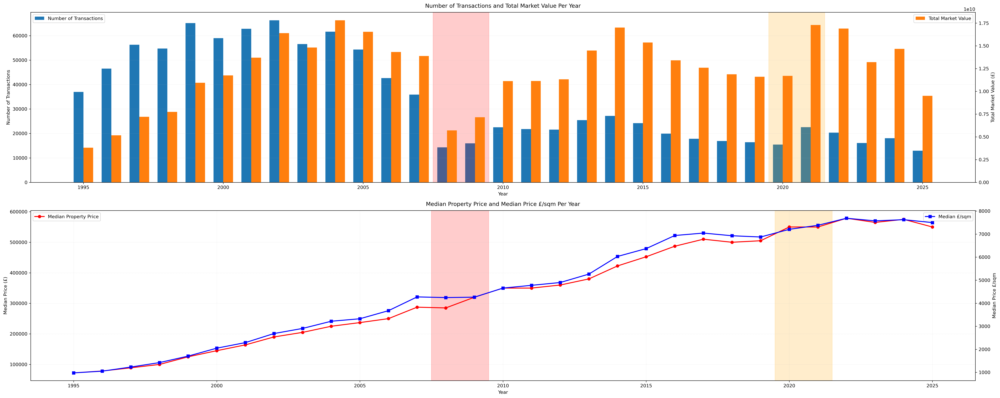

# London Housing: Geospatial Analysis & Property Price Modelling

An end-to-end analysis of the London residential property market combining **transaction data, Energy Performance Certificates and geospatial neighbourhood features** to understand what drives housing prices and build a practical price-estimation model.

The project analyses roughly **2.3 million London transactions across three decades**, matches transaction records to property-level EPC information, builds neighbourhood proxies for accessibility and local conditions, and applies the resulting dataset to both exploratory geospatial analysis and price modelling.

> Academic group project with equal contribution across the three team members. This repository is a cleaned portfolio version of the original coursework repository; candidate identifiers and course administration files have been removed.

## Research question

**Which observable property and location characteristics influence residential prices in London, and how well can those characteristics be used to estimate a property's market value?**

The project is deliberately broader than a prediction exercise. It first builds a consistent data layer, then examines London at multiple spatial scales, and only then trains a pricing model.

## Data pipeline

The analysis brings together several heterogeneous public sources:

- **HM Land Registry Price Paid Data** — residential transactions since 1995;
- **Energy Performance Certificate (EPC) data** — structural and energy-efficiency attributes;
- **London borough and postcode/outcode boundaries** — spatial aggregation and mapping;
- neighbourhood features capturing **transport accessibility, crime, green-space proximity and deprivation**;
- a small set of current property listings used as an external application of the final model.

A key engineering step is reconciling datasets with different geographic granularity. Property transactions and EPC records are matched, while local context is constructed at borough, outcode and LSOA levels before being brought into a common analytical table.

## Geospatial feature engineering

Location is treated as more than a borough label. The project constructs interpretable neighbourhood variables including:

- distance to the nearest Underground station;
- number of stations within 1 km;
- local crime rates;
- distance to major parks and open spaces;
- Index of Multiple Deprivation (IMD) decile;
- borough / outcode geography.

Distances are computed from geographic coordinates using the **Haversine formula**, while GeoJSON boundaries are used for choropleth and interactive spatial visualisations.


## Analysis and modelling

The analysis covers:

1. long-run transaction volumes and price dynamics;
2. borough-level and within-borough spatial variation;
3. transport, safety, green-space and deprivation trade-offs;
4. property type, size and room configuration;
5. energy-efficiency and running-cost variables;
6. multicollinearity and feature relationships;
7. a 34-feature linear regression pricing model;
8. application of the fitted model to current listings.

The final model achieved **R² ≈ 0.82** on the project evaluation split. Location, sale year, floor area and new-build status were among the most important explanatory variables in the study.

The project also used the model to compare estimated values with a small set of current listing prices, illustrating how an interpretable analytical model can be turned into a practical decision-support tool rather than ending at the modelling stage.



## Key findings

- London prices show strong and persistent **spatial heterogeneity**, both across boroughs and within boroughs.
- The project dataset matched roughly **70%** of transaction records to EPC information after integration and filtering.
- Over the study period, transaction volume declined substantially while prices increased, leaving total market value comparatively more stable.
- Property size, location, sale year and new-build status carry substantial explanatory power.
- Energy variables are strongly correlated with one another, making multicollinearity an important modelling consideration.
- Prime-location asking prices can diverge materially from a model based on historical transaction fundamentals, illustrating the limits of purely observable features.

## Tools

`Python` · `pandas` · `GeoPandas` · `Folium` · `scikit-learn` · `statsmodels` · `BeautifulSoup` · `requests` · `Matplotlib` · `Seaborn`

## Repository structure

```text
london-housing-geospatial-analysis/
├── README.md
├── notebooks/
│   └── london_housing_analysis.ipynb
├── data/
│   ├── london_boroughs.geojson
│   ├── london_postcodes.json
│   └── zoopla_listings.csv
├── figures/
│   └── ...
├── requirements.txt
└── .gitignore
```

Large government source datasets are intentionally **not committed** to the repository. The notebook documents the original sources and contains download / acquisition logic for the processed datasets used in the analysis.

## Running the project

```bash
python -m venv .venv
source .venv/bin/activate
pip install -r requirements.txt
jupyter notebook notebooks/london_housing_analysis.ipynb
```

The notebook uses live/public web sources in parts of the feature-engineering pipeline, so full reproduction depends on those services remaining available.

## Beyond the notebook

The original project also produced a small **Streamlit property-price estimator**, turning the fitted model into a simple user-facing application. The notebook documents the modelling and validation process behind that prototype.

## Limitations

The model is designed as an interpretable analytical benchmark, not a professional property valuation system. Asking prices and completed transaction prices are not directly equivalent; unobserved factors such as interior condition, exact street position, lease terms and prestige can create large residuals. Several local-context variables are proxies and should be interpreted as associations rather than causal effects.
